<p align="center">
  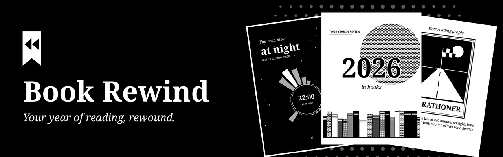
</p>

<p align="center">
  <strong>A yearly reading recap for KOReader, in illustrated cards made for e-ink.<br>Offline, on your device.</strong>
</p>

<p align="center">
  <a href="https://github.com/davydmaker/book_rewind.koplugin/releases/latest"></a>
  <a href="https://github.com/davydmaker/book_rewind.koplugin/actions/workflows/ci.yml"></a>
  <a href="https://github.com/davydmaker/book_rewind.koplugin/releases"></a>
  <a href="https://koreader.rocks"></a>
  
  
  <a href="LICENSE"></a>
  <a href="LICENSE-CONTENT"></a>
</p>

<p align="center">
  <a href="#the-cards">The cards</a> ·
  <a href="#reader-profiles">Reader profiles</a> ·
  <a href="#installation">Installation</a> ·
  <a href="#your-data-stays-with-you">Your data</a> ·
  <a href="#development">Development</a> ·
  <a href="README_pt.md">Leia em português</a>
</p>

## The cards

Up to 18 cards tell the story of your year. Each one only appears when there is data for it, so even a short history makes a coherent sequence.

<table>
  <tr>
    <td width="25%" align="center">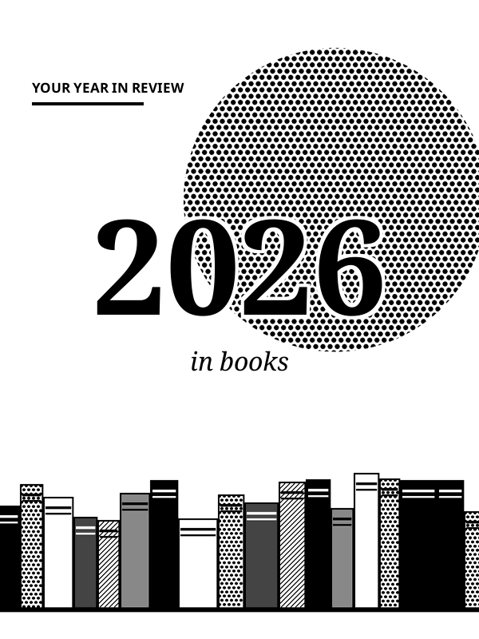<br><sub><b>Your year</b></sub></td>
    <td width="25%" align="center">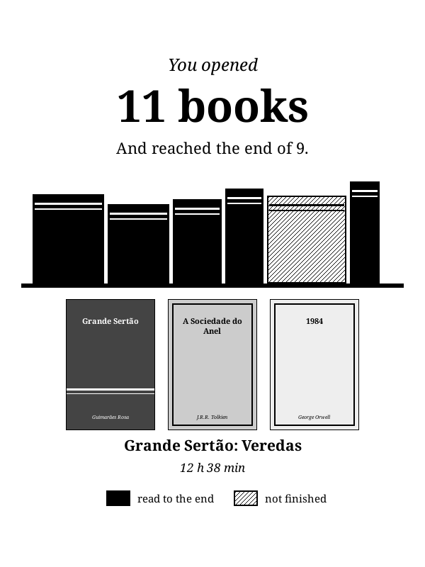<br><sub><b>Your shelf</b></sub></td>
    <td width="25%" align="center">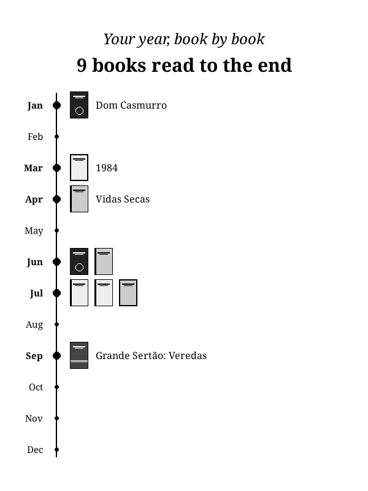<br><sub><b>Your timeline</b></sub></td>
    <td width="25%" align="center">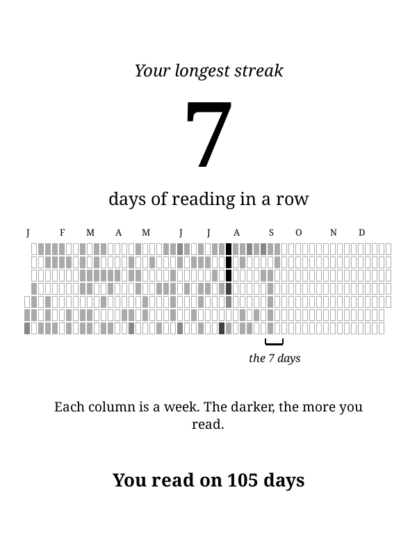<br><sub><b>Your streak</b></sub></td>
  </tr>
  <tr>
    <td width="25%" align="center">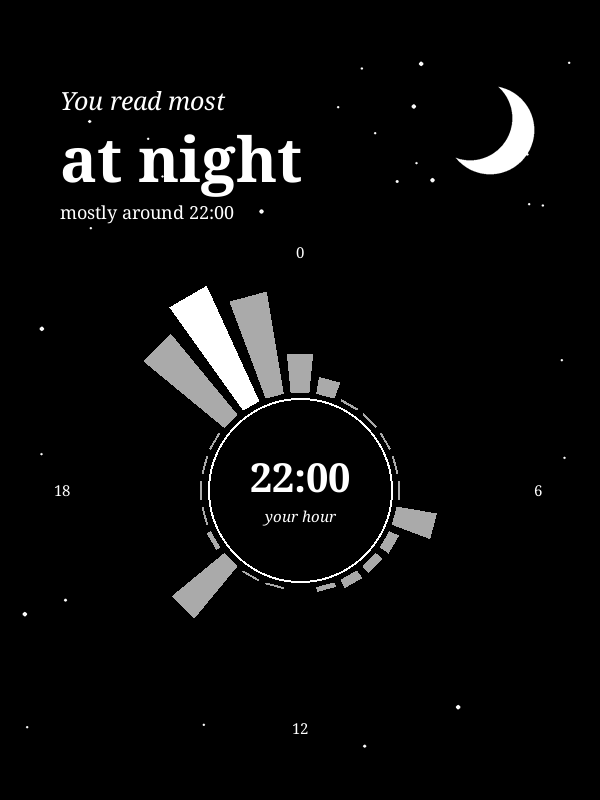<br><sub><b>Your hours</b></sub></td>
    <td width="25%" align="center">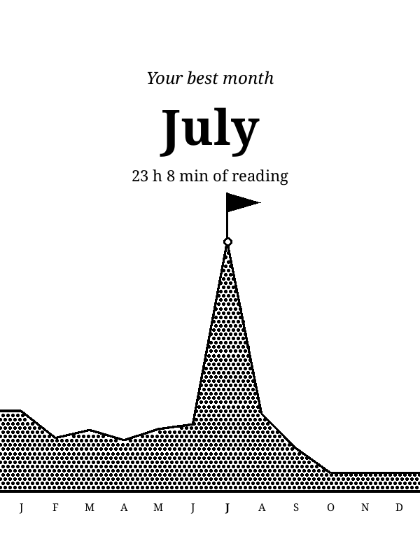<br><sub><b>Your best month</b></sub></td>
    <td width="25%" align="center">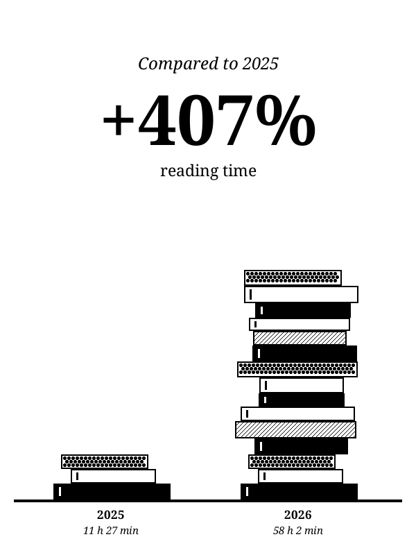<br><sub><b>Your progress</b></sub></td>
    <td width="25%" align="center">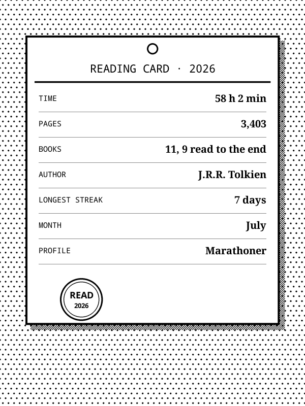<br><sub><b>Your summary</b></sub></td>
  </tr>
</table>

You also get total time and pages, your top author, the book you devoured, your biggest day, your longest session, your favorite weekday and your pace.

**Save Images** writes the cards as PNG files to KOReader's screenshots folder, ready to share.

## Reader profiles

Every year ends with a card that describes how you read. Your strongest trait wins, and the next one shows up as a secondary touch.

<table>
  <tr>
    <td width="25%" align="center">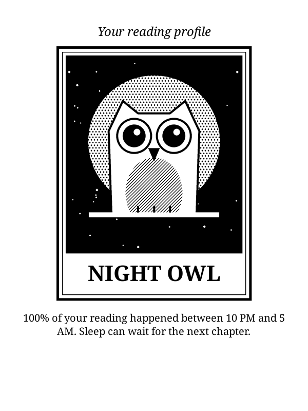<br><sub><b>Night Owl</b><br>Reads from 10 PM to 5 AM</sub></td>
    <td width="25%" align="center">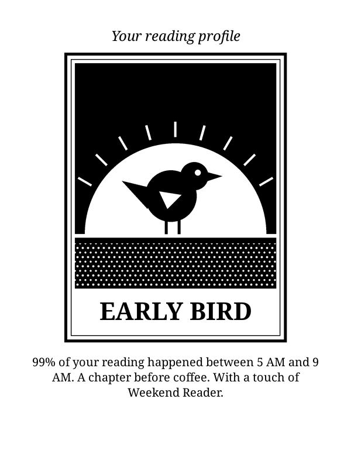<br><sub><b>Early Bird</b><br>Reads from 5 AM to 9 AM</sub></td>
    <td width="25%" align="center">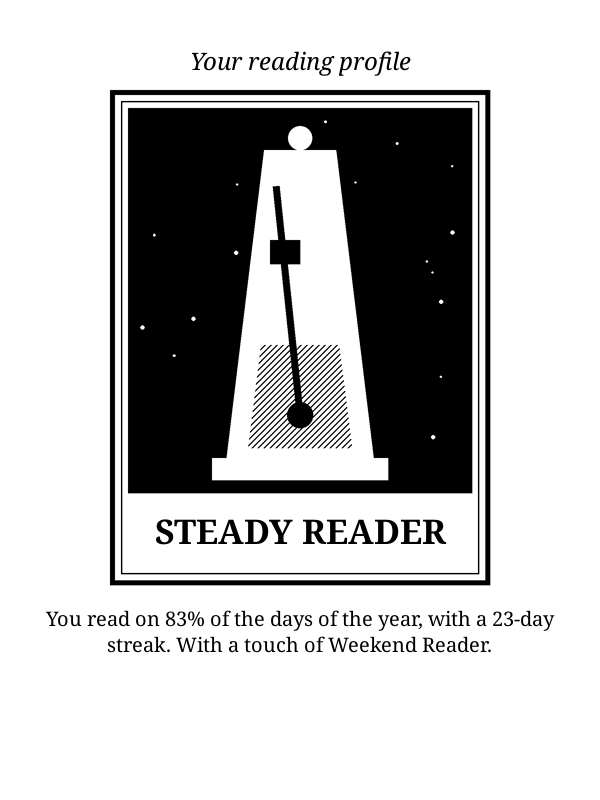<br><sub><b>Steady Reader</b><br>Reads most days of the year</sub></td>
    <td width="25%" align="center">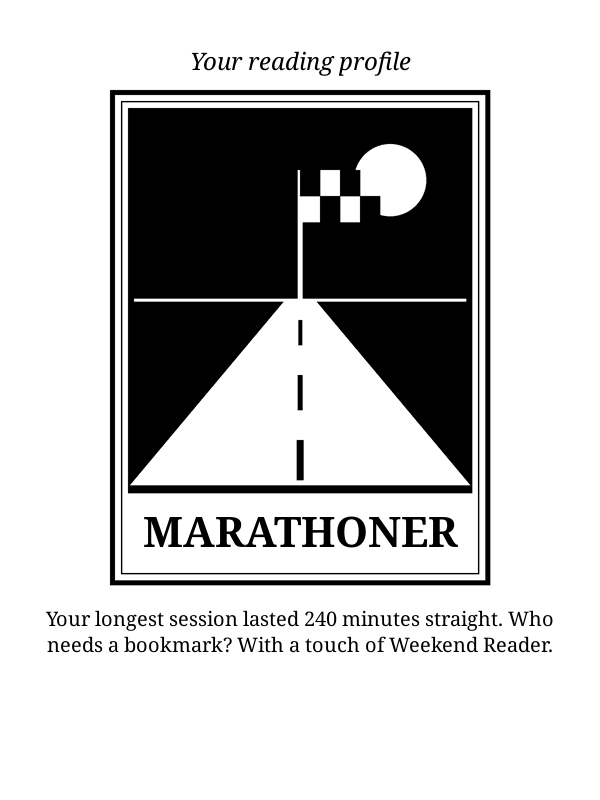<br><sub><b>Marathoner</b><br>Keeps having long sessions</sub></td>
  </tr>
  <tr>
    <td width="25%" align="center"><br><sub><b>Loyal Reader</b><br>Sticks with one author</sub></td>
    <td width="25%" align="center">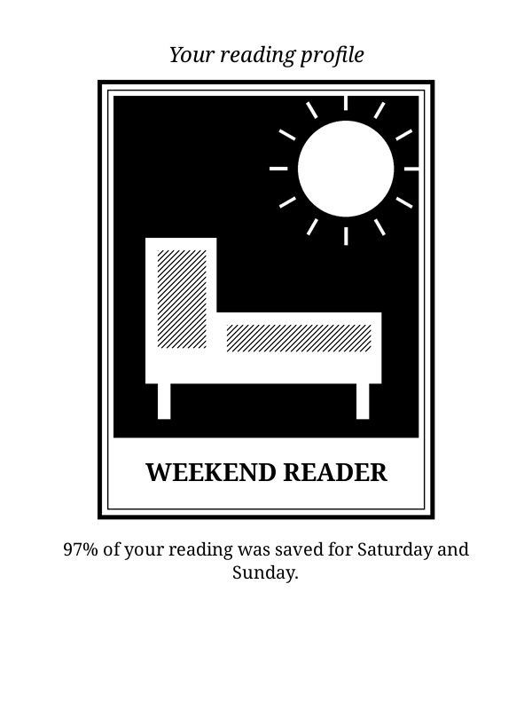<br><sub><b>Weekend Reader</b><br>Saves it for the weekend</sub></td>
    <td width="25%" align="center">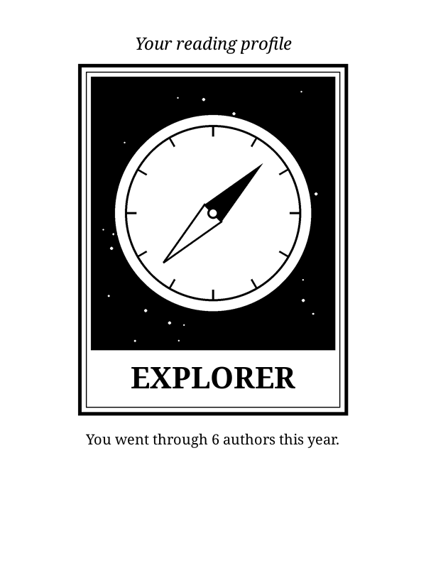<br><sub><b>Explorer</b><br>Spreads time across many authors</sub></td>
    <td width="25%" align="center">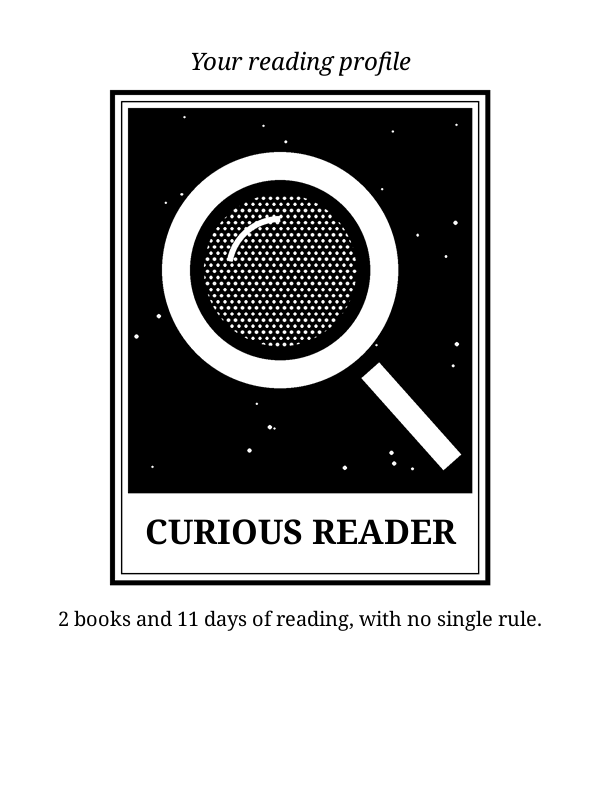<br><sub><b>Curious Reader</b><br>Follows no single rule</sub></td>
  </tr>
</table>

## Installation

1. Download `book_rewind.koplugin.zip` from the [latest release](https://github.com/davydmaker/book_rewind.koplugin/releases/latest).
2. Extract it into `koreader/plugins/`, so that `koreader/plugins/book_rewind.koplugin/main.lua` exists.
3. Restart KOReader. The plugin is in the Tools menu, as **Book Rewind**.

The language follows KOReader's: English, Portuguese or Spanish. In any other language, it uses English.

> [!TIP]
> A year needs at least 10 minutes of reading to get its cards. In the first 30 days of a new year, the plugin opens on the year that just ended.

## Your data stays with you

> [!NOTE]
> Book Rewind only reads KOReader's statistics (`statistics.sqlite3`) and the library's cover cache (`bookinfo_cache.sqlite3`), both read-only. It makes no network connections, and nothing leaves your device.

<details>
<summary><b>How the numbers work</b></summary>

<br>

- **It only counts what went through KOReader.** Reading in other apps is not included.
- **Title and author** come from the file. Without a title, it shows the file name. Without an author, the book stays out of the authors card.
- **Read to the end** means 90% of the book read in KOReader. It counts in the year that mark is reached, even for a book started years before.
- **Pages** count the part of the book you covered, so rereading a passage at another font size does not add up twice.
- **Covers** come from KOReader's library. Books with no cached cover get one generated on the spot, with the title and author.

The complete rules, including the thresholds of each profile, are in [docs/design.md](docs/design.md).

</details>

## Compatibility

- Tested with KOReader 2026.07 on a 10th generation basic Kindle (firmware 5.18.1).
- Layout checked in the emulator at 600x800, 758x1024, 1072x1448 and 1264x1680.
- Made for touchscreens. On devices with keys, the page keys navigate and the back key closes, but changing the year and saving images need touch.
- Always in portrait. Opened in landscape, it rotates the screen and restores the rotation on exit.

## Development

With [LuaJIT](https://luajit.org) installed, from the repository root:

```sh
luajit tests/stats_spec.lua
```

Metrics, remaining tools and the release process are described in [docs/design.md](docs/design.md). Contributions are accepted under the project's licenses.

## License

This project has two licenses. See [NOTICE](NOTICE) for details.

- **Code:** [GPL-3.0](LICENSE), version 3 only. You may use, study, modify and redistribute it, keeping it open under the same license.
- **Art and texts:** [CC BY-NC-SA 4.0](LICENSE-CONTENT). You may share and adapt them with credit and under the same license, for non-commercial purposes.

These licenses grant no rights to the names "Book Rewind" and "Davyd Maker". For other uses, contact [Davyd Maker](https://davydmaker.com).

---

<p align="center">
  <br>
  <sub>Made by <a href="https://davydmaker.com">Davyd Maker</a></sub>
</p>
