<p align="center">
  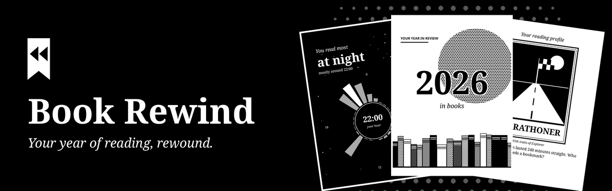
</p>

<p align="center">
  <strong>Uma retrospectiva anual de leitura para o KOReader, em cartões ilustrados feitos para e-ink.<br>Sem internet, no seu aparelho.</strong>
</p>

<p align="center">
  <a href="https://github.com/davydmaker/book_rewind.koplugin/releases/latest"></a>
  <a href="https://github.com/davydmaker/book_rewind.koplugin/actions/workflows/ci.yml"></a>
  <a href="https://github.com/davydmaker/book_rewind.koplugin/releases"></a>
  <a href="https://koreader.rocks"></a>
  
  
  <a href="LICENSE"></a>
  <a href="LICENSE-CONTENT"></a>
</p>

<p align="center">
  <a href="#os-cartões">Os cartões</a> ·
  <a href="#perfis-de-leitura">Perfis de leitura</a> ·
  <a href="#instalação">Instalação</a> ·
  <a href="#seus-dados-ficam-com-você">Seus dados</a> ·
  <a href="#desenvolvimento">Desenvolvimento</a> ·
  <a href="README.md">Read in English</a>
</p>

## Os cartões

Até 21 cartões contam a história do seu ano. Cada um só aparece quando há dados para ele, então mesmo um histórico curto forma uma sequência coerente.

<table>
  <tr>
    <td width="25%" align="center">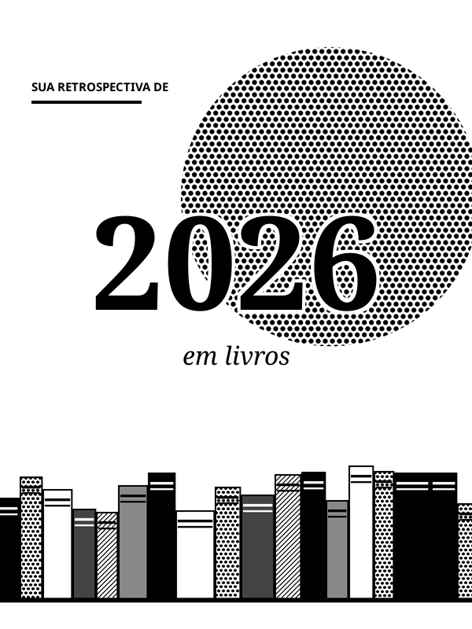<br><sub><b>Seu ano</b></sub></td>
    <td width="25%" align="center">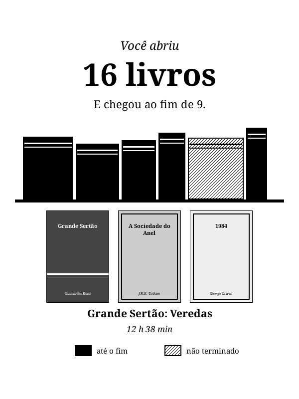<br><sub><b>Sua estante</b></sub></td>
    <td width="25%" align="center">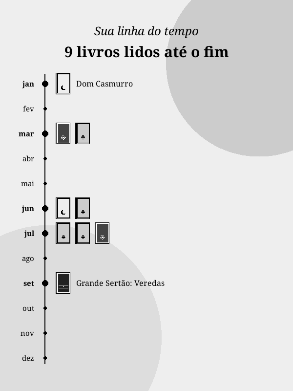<br><sub><b>Sua linha do tempo</b></sub></td>
    <td width="25%" align="center">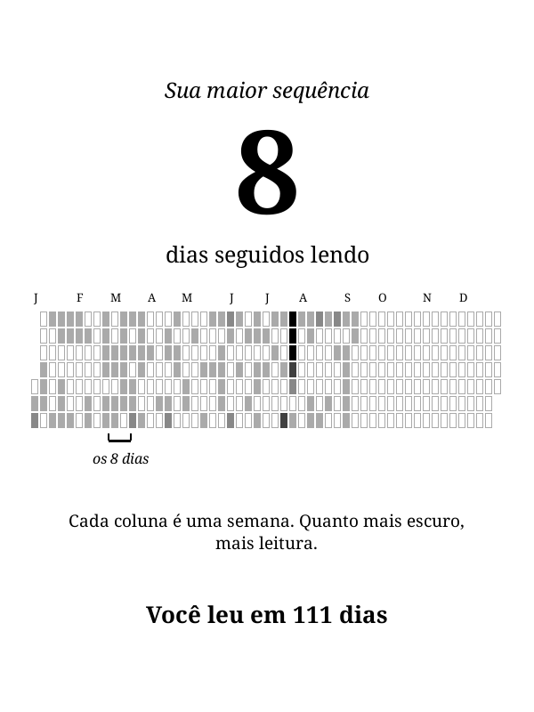<br><sub><b>Sua sequência</b></sub></td>
  </tr>
  <tr>
    <td width="25%" align="center">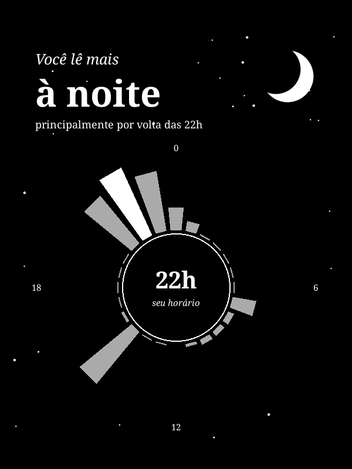<br><sub><b>Seus horários</b></sub></td>
    <td width="25%" align="center">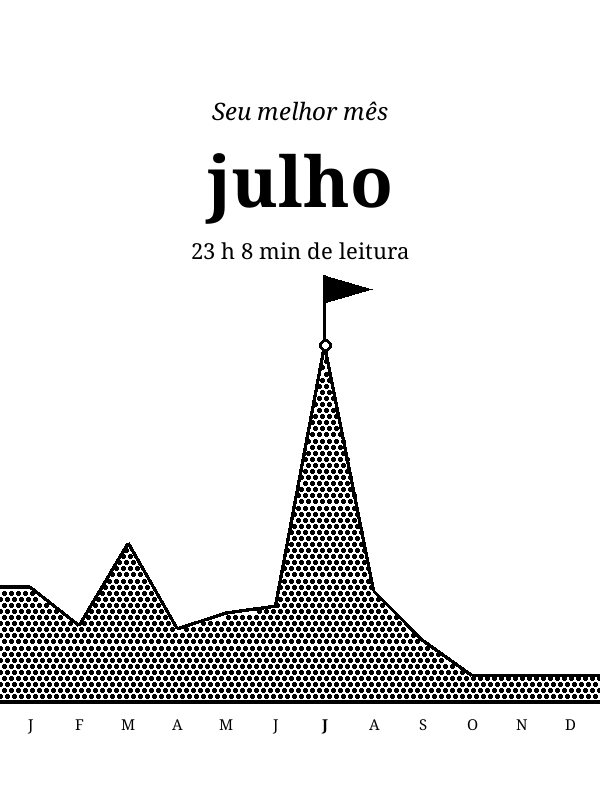<br><sub><b>Seu melhor mês</b></sub></td>
    <td width="25%" align="center">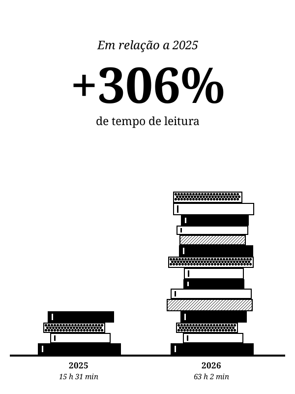<br><sub><b>Sua evolução</b></sub></td>
    <td width="25%" align="center">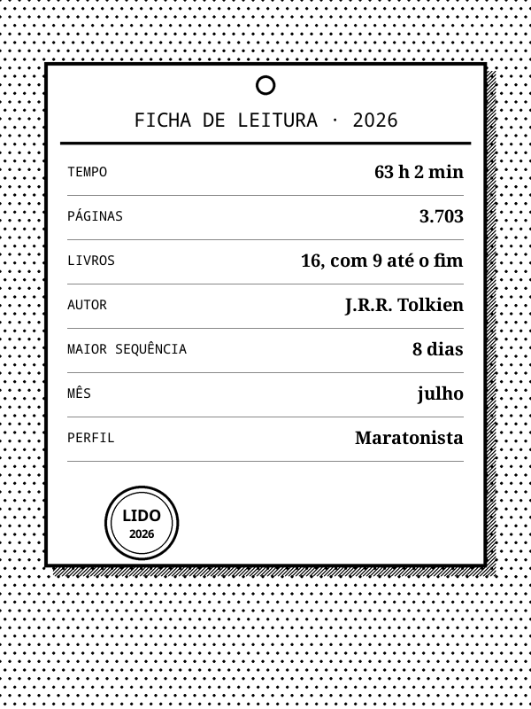<br><sub><b>Seu resumo</b></sub></td>
  </tr>
</table>

Também aparecem o tempo e as páginas do ano, o autor mais lido, o livro devorado, o maior dia, a maior sessão, o dia da semana favorito e o seu ritmo.

### Coringas

Até 3 cartões raros por ano, para o que realmente se destacou: a volta depois de uma longa pausa, um livro lido em um dia, uma série inteira, uma releitura, noites depois da meia-noite e mais, entre 17. Um ano sem nada marcante não mostra nenhum.

<table>
  <tr>
    <td width="25%" align="center">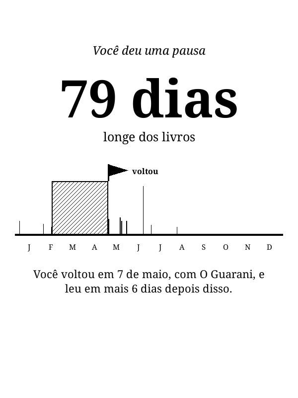<br><sub><b>A volta</b></sub></td>
    <td width="25%" align="center">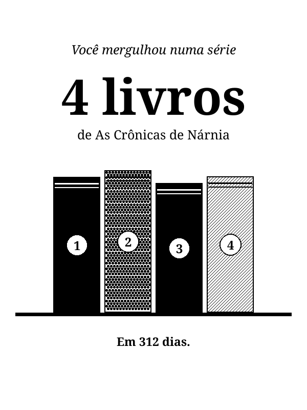<br><sub><b>Maratona de série</b></sub></td>
    <td width="25%" align="center">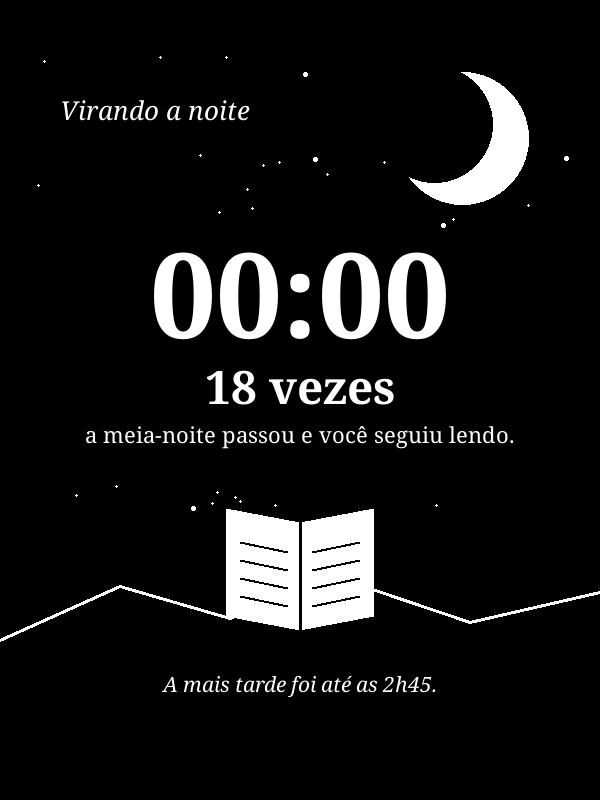<br><sub><b>Virando a noite</b></sub></td>
    <td width="25%" align="center">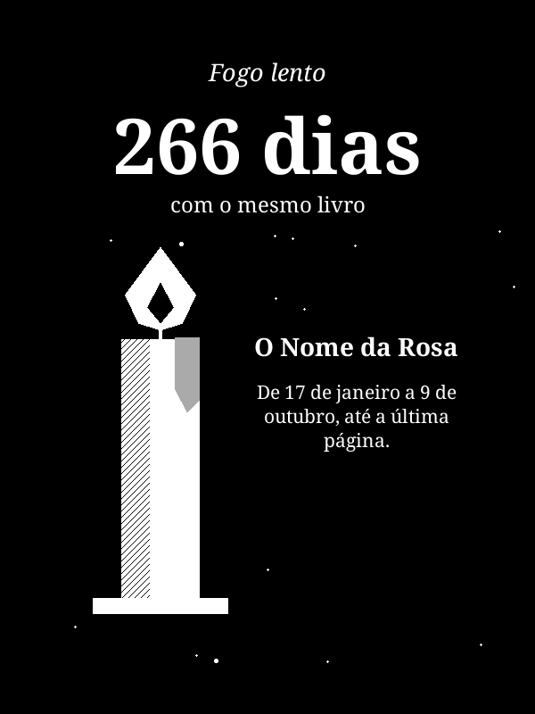<br><sub><b>Fogo lento</b></sub></td>
  </tr>
</table>

**Salvar Imagens** grava os cartões como PNG na pasta de capturas do KOReader, prontos para compartilhar.

## Perfis de leitura

Cada ano termina com um cartão que descreve como você lê. Vence o seu traço mais forte, e o seguinte aparece como traço secundário.

<table>
  <tr>
    <td width="25%" align="center">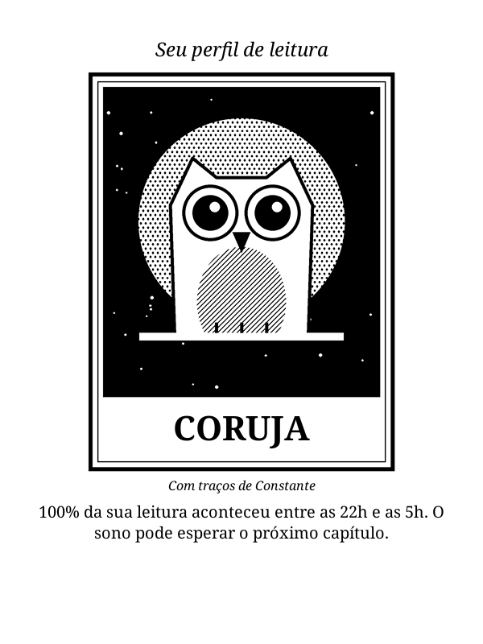<br><sub><b>Coruja</b><br>Lê entre as 22h e as 5h</sub></td>
    <td width="25%" align="center">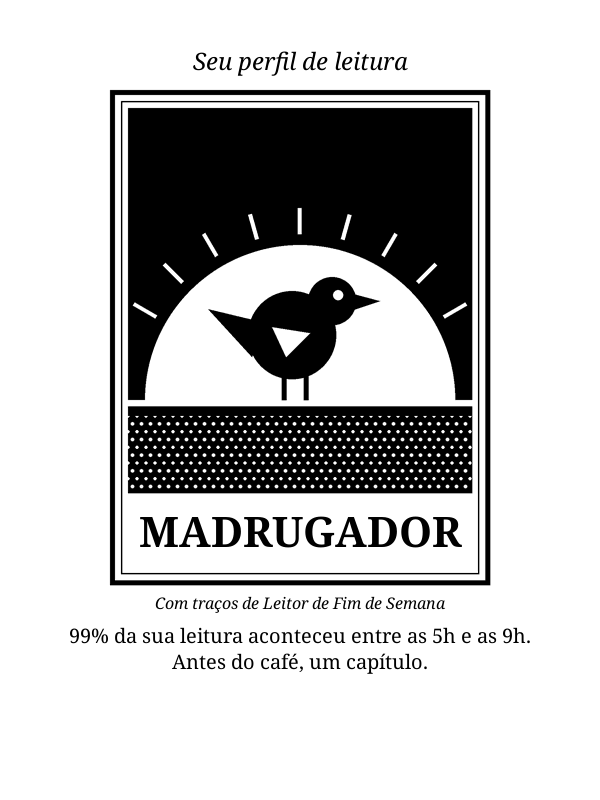<br><sub><b>Madrugador</b><br>Lê entre as 5h e as 9h</sub></td>
    <td width="25%" align="center">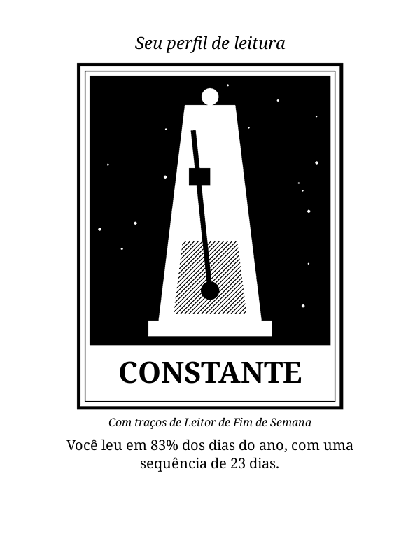<br><sub><b>Constante</b><br>Lê na maioria dos dias do ano</sub></td>
    <td width="25%" align="center">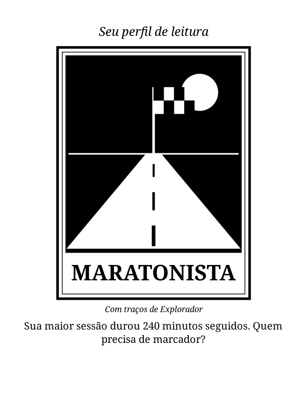<br><sub><b>Maratonista</b><br>Faz sessões longas com frequência</sub></td>
  </tr>
  <tr>
    <td width="25%" align="center">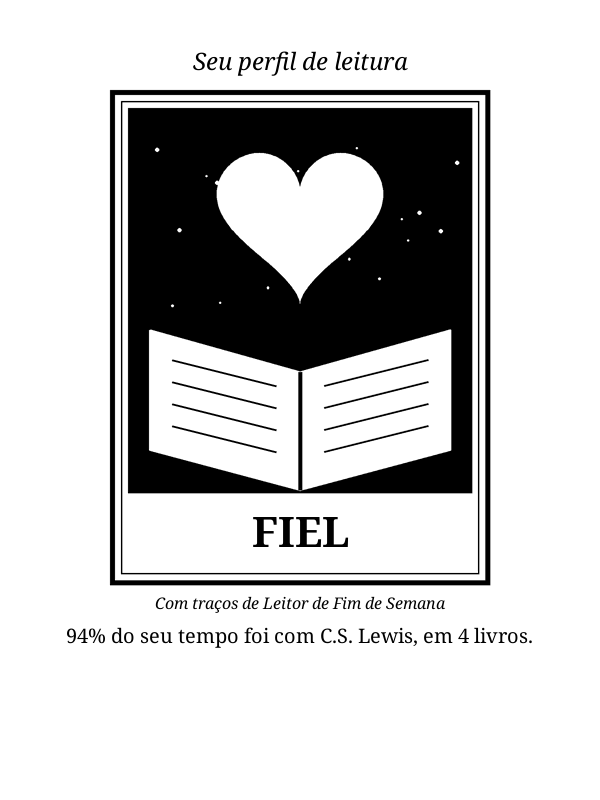<br><sub><b>Fiel</b><br>Fica com um só autor</sub></td>
    <td width="25%" align="center">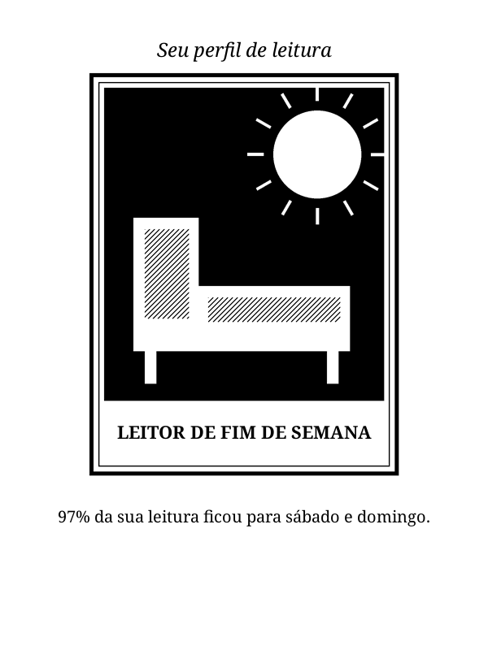<br><sub><b>Leitor de Fim de Semana</b><br>Deixa para sábado e domingo</sub></td>
    <td width="25%" align="center">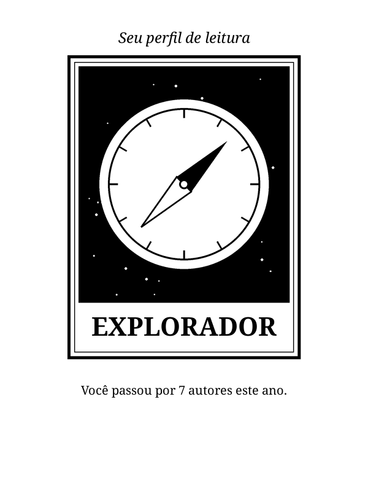<br><sub><b>Explorador</b><br>Divide o tempo entre muitos autores</sub></td>
    <td width="25%" align="center">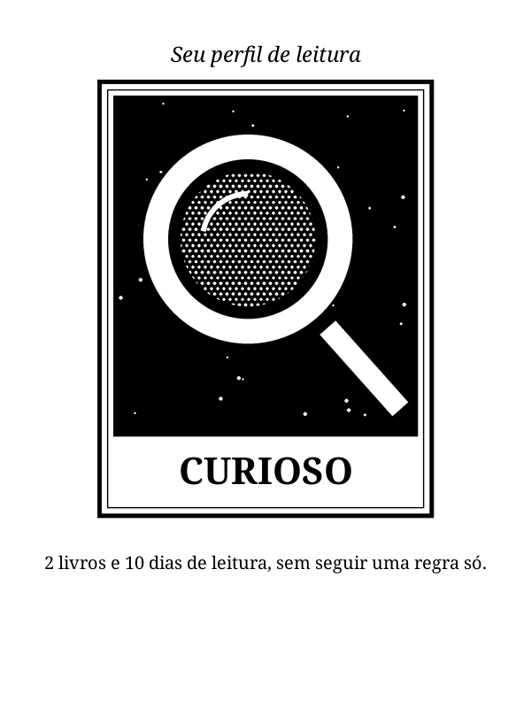<br><sub><b>Curioso</b><br>Não segue uma regra só</sub></td>
  </tr>
</table>

## Instalação

1. Baixe `book_rewind.koplugin.zip` na [última versão](https://github.com/davydmaker/book_rewind.koplugin/releases/latest).
2. Extraia em `koreader/plugins/`, de modo que exista o arquivo `koreader/plugins/book_rewind.koplugin/main.lua`.
3. Reinicie o KOReader. O plugin fica em Ferramentas, como **Book Rewind**.

O idioma acompanha o do KOReader: inglês, português ou espanhol. Em outros idiomas, ele fica em inglês.

> [!TIP]
> Um ano precisa de pelo menos 10 minutos de leitura para ter cartões. Nos primeiros 30 dias de um ano novo, o plugin abre no ano que acabou.

## Seus dados ficam com você

> [!NOTE]
> O Book Rewind só lê as estatísticas do KOReader (`statistics.sqlite3`) e o cache de capas da biblioteca (`bookinfo_cache.sqlite3`), em modo somente leitura. Ele não faz conexões de rede, e nada sai do aparelho.

<details>
<summary><b>Como os números funcionam</b></summary>

<br>

- **Só conta o que passou pelo KOReader.** Leitura em outros apps não entra.
- **Título e autor** vêm do arquivo. Sem título, aparece o nome do arquivo. Sem autor, o livro fica fora do cartão de autores.
- **Livro até o fim** significa 90% do livro lido no KOReader. Conta no ano em que chega a essa marca, mesmo para um livro começado anos antes.
- **Páginas** contam o trecho do livro que você cobriu, então reler um trecho com outro tamanho de fonte não soma duas vezes.
- **Capas** vêm da biblioteca do KOReader. Livros sem capa no cache ganham uma gerada na hora, com o título e o autor.

As regras completas, com os limites de cada perfil, estão em [docs/design.md](docs/design.md), em inglês.

</details>

## Compatibilidade

- Testado com o KOReader 2026.07 num Kindle básico da 10ª geração (firmware 5.18.1).
- Layout conferido no emulador em 600x800, 758x1024, 1072x1448 e 1264x1680.
- Feito para telas sensíveis ao toque. Em aparelhos com teclas, as de página navegam e a de voltar fecha, mas trocar de ano e salvar imagens exigem toque.
- Sempre em retrato. Aberto em paisagem, ele gira a tela e restaura a rotação ao fechar.

## Desenvolvimento

Com [LuaJIT](https://luajit.org) instalado, a partir da raiz do repositório:

```sh
luajit tests/stats_spec.lua
```

As métricas, as demais ferramentas e o processo de publicação estão em [docs/design.md](docs/design.md), em inglês. Contribuições entram sob as mesmas licenças do projeto.

## Licença

O projeto tem duas licenças. Os detalhes estão em [NOTICE](NOTICE).

- **Código:** [GPL-3.0](LICENSE), somente a versão 3. Você pode usar, estudar, modificar e redistribuir, mantendo o código aberto sob a mesma licença.
- **Artes e textos:** [CC BY-NC-SA 4.0](LICENSE-CONTENT). Você pode compartilhar e adaptar, com crédito e a mesma licença, sem uso comercial.

As licenças não dão direito de uso sobre os nomes "Book Rewind" e "Davyd Maker". Para outros usos, fale com [Davyd Maker](https://davydmaker.com).

---

<p align="center">
  <br>
  <sub>Feito por <a href="https://davydmaker.com">Davyd Maker</a></sub>
</p>
